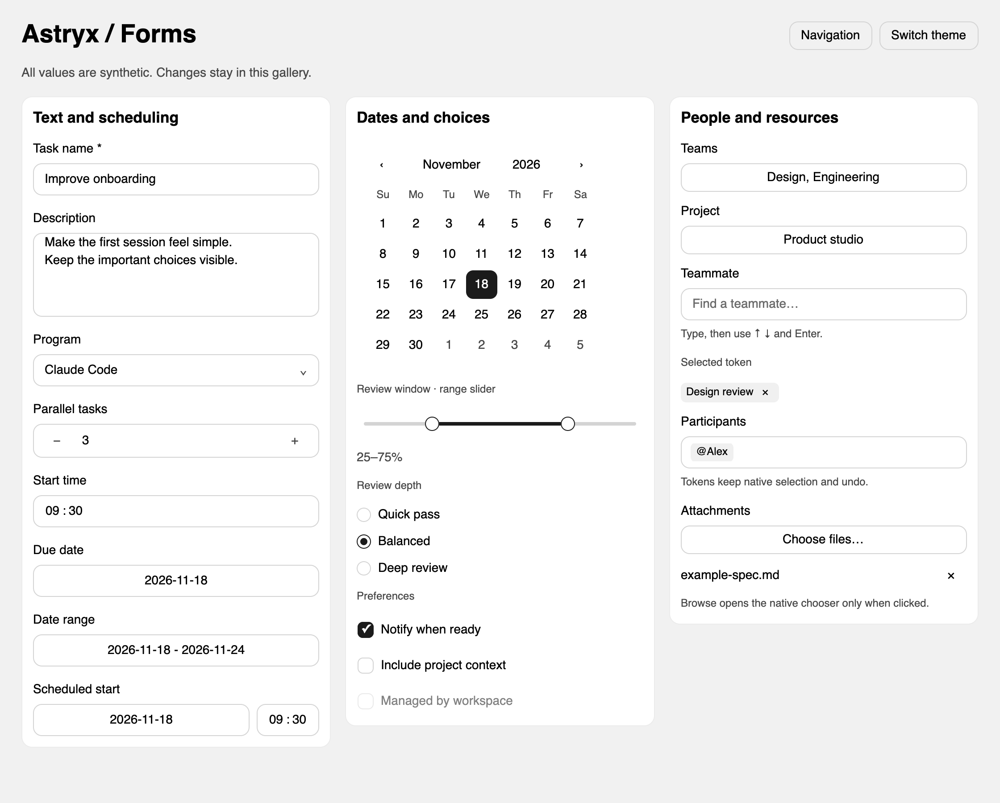

# Astryx GPUI

An **unofficial community port** of [Meta's Astryx](https://github.com/meta/astryx) Neutral design language to native Rust GPUI. It draws with GPUI rather than a web view. This project is independent of Meta and does not provide drop-in compatibility with the React package.


[Dark gallery](docs/assets/gallery-dark.png) · [Pinned source map](docs/source-map.md)

## Native coverage

All **102 public UI families** in the pinned Astryx catalogue now have working
native counterparts. [Coverage](docs/coverage.md) lists each source family,
public Rust API, supported behavior and native adaptations. This means coverage
of each family's core purpose, not every React prop/variant or pixel parity.
The 11 supporting source export groups are documented separately.

| Area | Native capabilities |
| --- | --- |
| Foundations and layout | Explicit light/dark Theme, text, cards, stacks, grid, aspect ratio, sections, application shell and layout slots |
| Forms | Native text/IME/history, selectors, token editing, checkbox/radio/switch/slider, calendar/date/time/number and OS file selection |
| Navigation | Tabs, toolbars, breadcrumbs, controlled top/side/mobile navigation, pagination and stepper |
| Layers and search | Focus-managed dialogs, drawers/sheets, menus, popovers, hover help, alerts, lightbox, command palette and sectioned search |
| Collections and geometry | Selectable/reorderable lists, native table and virtual tree, carousel, swipe, snapping, resizing, scrolling and overflow |
| Content and feedback | Native Markdown/code clipboard, controlled chat, citations, media fallbacks, timers, toast/progress/loading/status |

Representative native galleries use live retained state and callbacks:

```sh
cargo run --locked --example controls
cargo run --locked --example forms
cargo run --locked --example forms -- --navigation
cargo run --locked --example layers
cargo run --locked --example layers -- --dialog
cargo run --locked --example content
cargo run --locked --example geometry
```

Each accepts `--dark` and `--snapshot PATH`. The source examples show which
models the owning view observes and which data or navigation callbacks it owns.



[Forms dark](docs/assets/forms-dark.png) ·
[Layers light](docs/assets/layers-light.png) ·
[Layers dark](docs/assets/layers-dark.png) ·
[Alert dialog](docs/assets/layers-dialog.png) ·
[Content light](docs/assets/content-light.png) ·
[Content dark](docs/assets/content-dark.png) ·
[Geometry light](docs/assets/geometry-light.png) ·
[Geometry dark](docs/assets/geometry-dark.png)

## Run the native gallery

A macOS build environment with Command Line Tools is required for the currently verified platform. Rust **1.95.0**, rustfmt and clippy are pinned in `rust-toolchain.toml`; installing them does not change your global default toolchain.

```sh
git clone https://github.com/geonsang-jo/astryx-gpui.git
cd astryx-gpui
cargo run --locked --example gallery
cargo run --locked --example gallery -- --dark
```

The gallery supports real checkbox, tab, disclosure, button counter and theme state. Its own root handles Tab / Shift+Tab focus traversal. The library does not install application-wide navigation keybindings.

Capture a real offscreen GPUI render through the same gallery:

```sh
cargo run --locked --example gallery -- --snapshot artifacts/gallery-light.png
cargo run --locked --example gallery -- --dark --snapshot artifacts/gallery-dark.png
cargo run --locked --example gallery -- --focus-primary --snapshot artifacts/gallery-focus.png
```

The capture path uses the public GPUI test renderer and the platform text system. It does not render HTML or substitute a screenshot mockup.

## Use in a GPUI host

This crate targets the **`gpui-pre` 0.3.8** type family used by `gpui-base` 0.7.1. Depend on that package under the `gpui` name in your host. A different GPUI fork/version may expose different Rust types.

```toml
[dependencies]
astryx-gpui = { git = "https://github.com/geonsang-jo/astryx-gpui.git" }
gpui = { package = "gpui-pre", version = "=0.3.8", default-features = false }
```

Call `astryx_gpui::init(cx)` once during app initialization, before opening windows. It initializes the public `gpui-base` behavior primitives. Pin the git dependency to a reviewed commit for a reproducible application build.

Inside a view's `Render` implementation:

```rust,ignore
use astryx_gpui::{Button, ButtonVariant, Card, Checkbox, Text, TextKind, Theme};
use gpui::prelude::*;

let theme = Theme::light(); // or a theme retained/customized by the host
let change = cx.listener(|this, value: &bool, _, cx| {
    this.notifications = *value;
    cx.notify();
});

Card::new()
    .theme(theme)
    .child(Text::new("Notifications").kind(TextKind::Heading).theme(theme))
    .child(
        Checkbox::new("notifications", "Notify me about activity")
            .theme(theme)
            .checked(self.notifications)
            .on_change(move |value, window, cx| change(&value, window, cx)),
    )
    .child(
        Button::new("save", "Save")
            .theme(theme)
            .variant(ButtonVariant::Primary)
            .on_click(cx.listener(|this, _, _, cx| {
                this.save();
                cx.notify();
            })),
    )
```

Use stable, distinct control IDs in the owning window. Checkbox, Tabs and Collapsible request changes through callbacks; the host updates its value and calls `cx.notify()`. Rebuilding a component does not own or persist application state. Most presentation controls implement GPUI `Styled`; caller refinements apply after their defaults. Composable containers implement `ParentElement`; stateful collections use typed row/item builders.

The host owns data, provider/network operations, URL routing, fonts, focus traversal policy and persistence. Native file selection returns paths without reading or uploading their contents. Chat provides editing and callbacks without starting an AI provider. Some native models require the owning view to observe them for redraw, as demonstrated in the galleries. Components use inherited/system fonts; no Meta logo, font or icon asset is bundled.

## Verification

```sh
cargo fmt --check
cargo clippy --locked --all-targets -- -D warnings
cargo test --locked --lib --tests
cargo check --locked --examples
```

The integration suite dispatches native pointer/keyboard events to GPUI views and checks controlled state, disabled controls and tab navigation. Theme tests verify text and badge contrast. CI runs on macOS. Linux/Windows builds and assistive-technology behavior have not been validated; semantic roles are supplied by public GPUI primitives where available, and typography-only `TextKind::Heading` is not a semantic heading.

See [verification evidence](docs/verification.md), [design scope](docs/design.md), and [source and license provenance](THIRD_PARTY_NOTICES.md).

## Design provenance and license

The port follows Astryx's Neutral theme at commit `f4fa3661a25403ded7ee4c4c2ac5c2a355eb74ef`: neutral/status colors, 4px spacing scale, 12px cards, 10px buttons, and 14/20, 12/20, 17/24 typography. Native controls adapt React interactions to GPUI; exact pixel parity with the full upstream system is not claimed.

Original Rust work is [MIT licensed](LICENSE). The complete Meta MIT notice and dependency license guidance are in [THIRD_PARTY_NOTICES.md](THIRD_PARTY_NOTICES.md).
